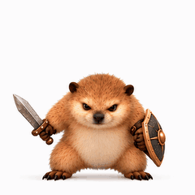

# we-stricker

「我的刀盾」表情包项目。

制作及提交前请遵循 [表情包制作基准](docs/sticker-standard.md)。

已确认文件专用目录：[confirmed](confirmed/README.md)。正式版本：[V1.0 表情清单](releases/v1.0/README.md)（持续收录，目前 2 个已确认表情）。

## 已确认表情

### 001 · 歪头疑问


[下载正式 GIF](releases/v1.0/stickers/001-歪头疑问.gif) · 240 × 240 像素 · 末帧停顿 1 秒。

### 002 · 蓄力怒吼（怒火）



[下载正式 GIF](confirmed/002-蓄力怒吼.gif) · 从蓄力开始，举刀仰天怒吼，侧面持盾，末帧停顿 1.2 秒。2026-10-22 确认纳入正式 V1.0。

## 素材归档

- [全部生成源图索引与补充历史稿](assets/source-archive/README.md)。
- [首套九宫格概念图](assets/concepts/首套九宫格概念图.png)：生成的表情方向展示，非用户原始多视角原型稿，也非可直接提交的单品。
- [歪头疑问源素材及制作脚本](assets/question-tilt/)。
- [仰天大吼初稿](assets/sky-roar/)。
- [蓄力怒吼前版](assets/sky-roar-charge/)。
- [侧盾修订及当前版本](assets/sky-roar-sideguard/)。

各素材目录保留关键帧、历史 GIF、制作脚本与版本说明；已确认 GIF 单独保存于 `confirmed/`，并在 `releases/v1.0/` 归档相同副本，实验修订不会自动覆盖正式文件。

## 本地重新导出

需要 Python、Pillow 和 NumPy。部分旧脚本还需要 FFmpeg（包含 `minterpolate` 滤镜）。

```sh
python -m pip install -r requirements.txt
python assets/sky-roar-sideguard/build_gif.py
```

请在各脚本中核对输出文件名，重新导出会覆盖对应的制作稿文件。制作规格见上方基准文档。
